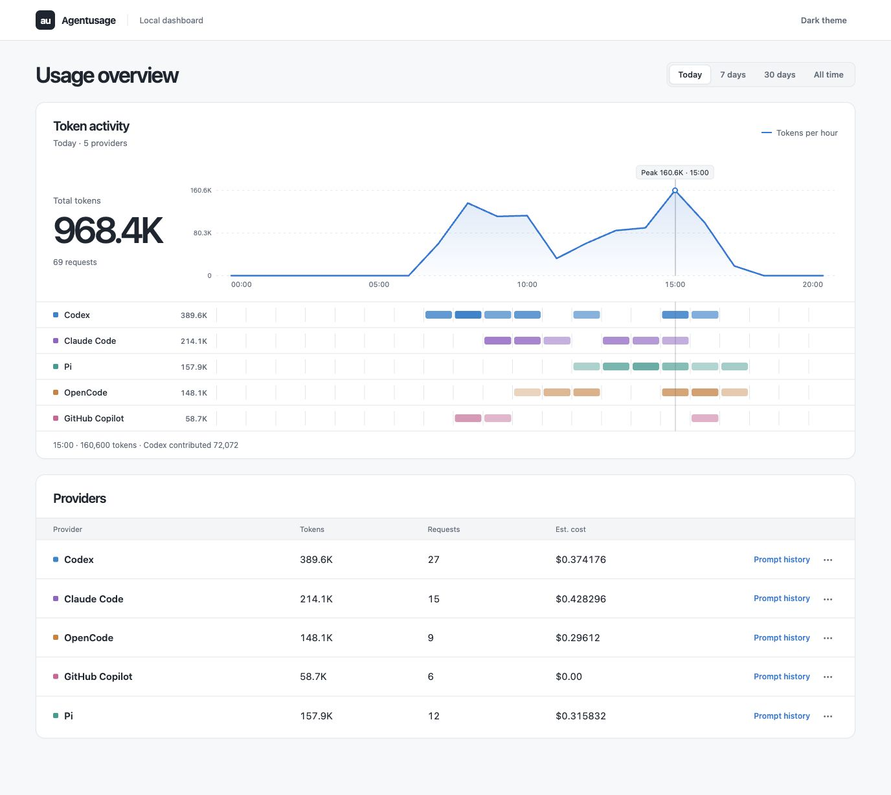
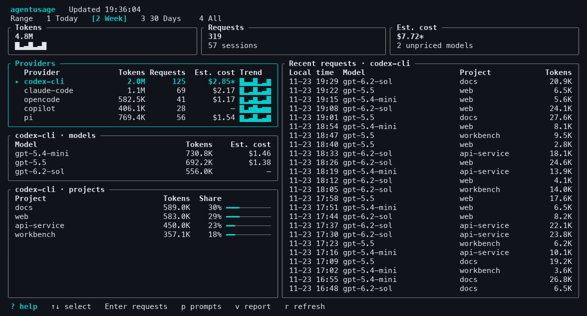
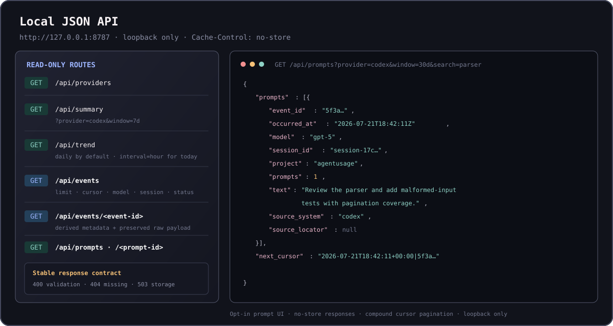
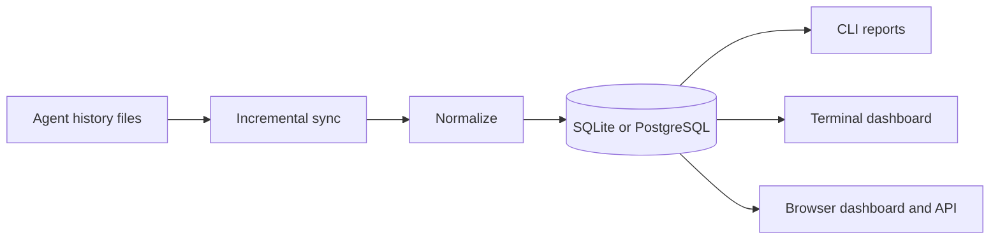

# Agentusage

[](https://github.com/binzhango/agentusage/actions/workflows/ci.yml)
[](https://github.com/binzhango/agentusage/releases/latest)
[](LICENSE)

**A private, local-first usage dashboard for AI coding agents.**

Agentusage turns the history already written by Codex, Claude Code, OpenCode,
Pi, and GitHub Copilot into a browser dashboard, terminal UI, JSON API, and CLI
reports. Use it to compare model activity, understand token and cache usage,
and track estimated cost without sending usage data to a hosted service.



## Highlights

- Find the busiest hour in **Today**, then select a provider row to see how much it contributed. Open the provider to compare models on the same timeline.
- See the share of Codex input read from cache. The model table shows exact read counts and adds a write column when a model records writes.
- Inspect individual requests in the terminal, including the source of their token totals. Open **Prompt history** in the browser or press `p` in the TUI to read recorded user messages.
- Export a provider report as SVG or query the same local data through the JSON API. Storage supports SQLite and PostgreSQL.

## Supported providers

| Provider | Local source | Imported data |
| --- | --- | --- |
| `codex` | Codex CLI and Desktop rollout JSONL | User prompts, tokens, models, cache reads and writes, estimated cost, sessions, code changes |
| `claude_code` | Claude Code session JSONL | User prompts, tokens, cache reads and creation, models, sessions, estimated cost |
| `opencode` | OpenCode session JSONL | Prompts, tokens, models, sessions, cost |
| `copilot` | Copilot CLI databases and VS Code logs | CLI/IDE attribution, models, tokens, AI credits |
| `pi` | Pi append-only session JSONL | Providers, models, prompts, tokens, cost, projects, tools |

## Install

Download a prebuilt archive from the
[latest release](https://github.com/binzhango/agentusage/releases/latest),
verify it against `SHA256SUMS`, and place the executables on your `PATH`.
Archives are available for macOS Apple Silicon, Linux ARM64, Linux x86_64, and
Windows x86_64.

With a current stable Rust toolchain, Cargo can install both executables.

```bash
cargo install agentusage --locked
au --version
```

`agentusage` and `au` run the same commands. To use the enhancements described here from a checkout, run `cargo install --path . --locked --bins`, then restart any running `au server` process.

Every launch performs a short release check. If a newer version is available,
Agentusage prints the release link and upgrade command. Commands also work offline.

## Quick start

### 1. Synchronize one provider

Start with a coding agent you already use:

```bash
au sync codex
```

Replace `codex` with `claude_code`, `opencode`, `copilot`, or `pi` as needed.
On first use, Agentusage asks where to store normalized usage. SQLite is the
default. Enter `s` at the prompt to create a provider database. On macOS and Linux, the default Codex database is `~/.local/state/agentusage/codex.db`.

For PostgreSQL, configure `AGENTUSAGE_POSTGRES_URL` before the first sync and
choose `p` at the storage prompt. See [Configuration](docs/CONFIGURATION.md#postgresql).

Synchronization reads the provider's existing local history without modifying
it. It is incremental and idempotent, so rerunning the same command imports
only new or changed records.

Synchronize additional providers only when you use them:

```bash
au sync claude_code
au sync opencode
au sync copilot
au sync pi
```

### 2. Choose how to view the data

```bash
# Interactive terminal dashboard
au dashboard

# Browser dashboard and local JSON API
au server --open

# One-off command-line report
au daily --provider codex
```

If the browser does not open automatically, visit
[http://127.0.0.1:8787](http://127.0.0.1:8787). Only synchronized providers
have data. An unavailable provider can be initialized with
`au sync <provider>` or hidden from the browser dashboard.

### Command map

| Command | Purpose |
| --- | --- |
| `au sync <provider>` | Import new local history into normalized storage |
| `au dashboard` | Open the interactive terminal dashboard |
| `au server --open` | Start the loopback-only browser dashboard and API |
| `au daily`, `weekly`, `monthly`, `yearly` | Synchronize and print a period report |
| `au range --from <DATE> --to <DATE>` | Synchronize and print an inclusive custom-range report |
| `au <command> --help` | Show all options for a command |

## Ways to explore usage

### Browser dashboard

```bash
au server --open
```

**Today** shows one point per hour from local midnight through the current hour. **7 days** and **30 days** show daily totals. **All time** uses the full history for provider totals and the latest 90 days for the chart. Hover over the chart or use the arrow keys with the chart focused to inspect a time bucket.

Select a provider name to open its usage breakdown. For Codex, **Cached input** is the percentage of input tokens served from cache in the selected period. Use the actions menu beside a provider to hide it or download its report. The browser remembers provider visibility and theme.

Choose **Prompt history** beside a provider or **Show prompts** on its page to load, search, and expand recorded user messages. Prompt bodies load on demand. Copilot’s local usage records omit prompt text. See the [usage guide](docs/USAGE.md#prompt-history) for supported prompt sources.

The server checks initialized providers at startup and every five minutes by default. Reload an open page to see newly imported events. See [automatic synchronization](docs/CONFIGURATION.md#automatic-synchronization) if recent Desktop sessions are missing.

### Terminal dashboard

```bash
au dashboard
```

The overview compares providers, then shows models and, when space permits, projects for the selected provider. At 110 columns or wider, recent requests appear alongside the provider table. A dash in the estimated-cost column means pricing is unavailable for the recorded usage. An asterisk marks a partial estimate.

| Action | Keys |
| --- | --- |
| Select a provider or row | Arrow keys or `j` / `k` |
| Open recent requests, then inspect a row | `Enter` twice |
| Open prompt history for the selected provider | `p`, then `Enter` to read a prompt |
| Open the provider report | `v` |
| Select Today, Week, 30 Days, or All | `1` through `4` |
| Synchronize, show shortcuts, or quit | `r`, `?`, or `q` |

See [terminal controls](docs/USAGE.md#terminal-dashboard) for scrolling, pane navigation, and copying text.



### CLI reports

```bash
au daily --provider codex
au weekly --provider codex
au monthly --provider copilot --month 2026-07
au range --provider pi --from 2026-07-01 --to 2026-07-31
```

The weekly CLI report covers Monday through Sunday. The dashboard’s seven-day window ends today. See [CLI reports](docs/USAGE.md#cli-reports) for sample output.

### JSON API

```bash
au server
curl 'http://127.0.0.1:8787/api/trend?provider=codex&window=today&interval=hour'
```

The local server exposes provider availability, aggregate summaries, hourly and daily
trends, paginated usage events, and searchable prompt history. See the
[API reference](docs/API.md) for routes and response fields.



## How it works

Agentusage reads provider history during incremental synchronization, normalizes
and deduplicates usage events, and stores them in a SQLite database per provider
or a shared PostgreSQL schema. CLI period reports synchronize the selected
provider before querying. Dashboards and API requests read stored usage.



SQLite and all browser endpoints are local by default. PostgreSQL is used only
when explicitly configured.

Codex includes cached input in its input total. Claude reports cache reads and writes as additional input. Agentusage uses a provider-reported total when available and otherwise applies the provider’s counting rules. See [token fields](docs/API.md#response-fields).

## Documentation

| Guide | Contents |
| --- | --- |
| [Usage guide](docs/USAGE.md) | Synchronization, dashboard, reports, Pi, and command examples |
| [API reference](docs/API.md) | HTTP routes, parameters, response fields, and error behavior |
| [Configuration](docs/CONFIGURATION.md) | Storage, automatic sync, PostgreSQL, and privacy |
| [Development](docs/DEVELOPMENT.md) | Local setup, tests, and contributor checks |
| [Releasing](docs/RELEASING.md) | Versioning, builds, crates.io, and GitHub releases |
| [Changelog](CHANGELOG.md) | Release history |

## Privacy and security

Agentusage does not require a hosted account and does not send usage data to a
project-controlled service. Provider history, prompt text, normalized
databases, raw events, and PostgreSQL credentials may contain sensitive
information and should be protected accordingly.

The HTTP server accepts loopback hosts only (`127.0.0.1`, `localhost`, or
`::1`) and has no built-in authentication.

## Contributing

Bug reports and pull requests are welcome. When changing provider ingestion:

1. Include a sanitized fixture or regression test when possible.
2. Preserve deterministic, idempotent normalization and documented token semantics.
3. Run the checks in [docs/DEVELOPMENT.md](docs/DEVELOPMENT.md).
4. Never commit credentials, private transcripts, or local databases.

## License

Agentusage is available under the [MIT License](LICENSE).
