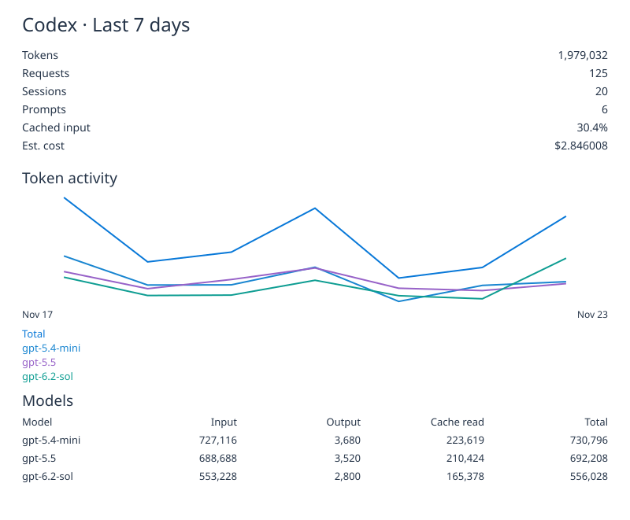

# Usage guide

This guide covers provider synchronization and the browser, terminal, and
command-line interfaces. For installation and a quick introduction, start with
the [README](../README.md).

## Synchronize provider data

Choose a provider you use and import its local history. For Codex Desktop and CLI sessions, run

```bash
au sync codex
```

The other provider names are `claude_code`, `opencode`, `copilot`, and `pi`. On first use, run sync in an interactive terminal and select a storage backend. SQLite creates a database per provider. PostgreSQL stores records from multiple providers in a shared schema.

Codex reads rollout files recursively under `~/.codex/sessions/`. If your sessions are in another directory, pass it for that import:

```bash
au sync codex --sessions-dir /path/to/codex/sessions
```

Sync reads the original files and updates derived storage. You can rerun it as files grow. If a provider shows **Unavailable**, run `au sync <provider>` in a terminal to see its storage status. For an old schema or a dashboard missing recent sessions, see [Configuration](CONFIGURATION.md#automatic-synchronization).

## Browser dashboard

Start the local server:

```bash
au server --open
```

The default URL is [http://127.0.0.1:8787](http://127.0.0.1:8787). Available
options are:

| Option | Default | Description |
| --- | --- | --- |
| `--host <HOST>` | `127.0.0.1` | Loopback host (`127.0.0.1`, `localhost`, or `::1`) |
| `--port <PORT>` | `8787` | TCP port |
| `--open` | disabled | Open the dashboard in the system browser |
| `--verbose` | disabled | Print request, backend, query, ingestion, and timing logs |

Example:

```bash
au server --host 127.0.0.1 --port 9000 --open
```

The page is embedded directly in the Rust binary. It does not require a
separate frontend server, Node.js runtime, hosted account, or external chart
service.

### Read the activity chart

| Window | Timeline | Provider totals |
| --- | --- | --- |
| Today | Local midnight through the current hour, in hourly buckets | Today |
| 7 days or 30 days | One point per day, including today | Selected period |
| All time | Daily activity over the latest 90 days | Full stored history |

The blue line shows tokens summed across visible providers. The marker starts at the peak. Point to another time or focus the chart and press the left or right arrow to read its exact token count. `Home` and `End` jump to the first and last bucket.

Each colored row shares the time axis. Filled cells indicate activity and darker cells indicate larger token counts. Select a row to isolate its provider, then select it again to restore the total. Select the provider **name in the list below** to open its page, where rows represent models. You can bookmark the provider and range together, for example `/provider/codex?window=30d`.

Use **Hide provider** in the provider actions menu to remove it from the overview and its aggregate chart. Use **Show hidden** above the provider list to restore it. The browser remembers visibility and theme.

### Read the Codex cache breakdown

**Cached input** is the share of input tokens served from cache over the selected period. Agentusage divides total cache-read tokens by total input tokens across requests. For example, 7,500 cached tokens out of 10,000 input tokens gives **75%**. A dash means there were no input tokens in the period.

The model table shows exact cache-read counts. The **Cache write** summary appears when Codex records a positive write count in the period. The table adds the **Cache write** column when at least one model records writes. A period can have substantial cache reads and zero reported writes. The [summary API](API.md#response-fields) exposes the underlying counters, including zeros.

### Export a provider report

Choose **Download SVG** from the provider actions menu or its full page. The export includes period totals, model trend lines, a legend, and usage tables. It follows the same Codex cache-display rules as the page. The prompt count is included, and prompt text stays in the history view. SVG files open offline.

This seven-day report was exported from a dashboard using sample data.



## Terminal dashboard

Start the interactive terminal UI:

```bash
au dashboard
```

Select a provider in the overview to see its models and, when there is room, its projects. In a terminal at least 110 columns wide, the recent-request list appears to the right. On narrower terminals, press `Enter` to open it. Press `Enter` on a request to inspect its model, tokens, status, source, and timing when available.

The **Week** and **30 Days** windows show trends when space permits. Each bar covers one day for Week or three days for 30 Days. The provider report includes spending by period and model, client, and project breakdowns. In the overview, a dash in the estimated-cost column means pricing is missing for the recorded usage. An asterisk marks a subtotal with unpriced models.

| Keys | Action |
| --- | --- |
| `↑` / `↓`, `j` / `k` | Select a row or scroll an open record |
| `←` / `→`, `h` / `l` | Switch provider |
| `Enter` | Open requests, inspect a selected row, or close its detail |
| `Tab` | Switch between provider and request views |
| `p` | Open prompt history for the selected provider, or switch back to requests |
| `v` | Open or close the provider usage report |
| `1` / `2` / `3` / `4`, `w` | Select Today / Week / 30 Days / All, or cycle windows |
| `PageUp` / `PageDown`, mouse wheel | Move through the list or detail |
| `Ctrl+U` / `Ctrl+D`, `b` / `Space` | Move eight rows up or down |
| `Ctrl+B` / `Ctrl+F`, `Home` / `End` | Move twenty rows, or jump to the beginning or end |
| `r` | Synchronize and refresh |
| `m` | Toggle mouse capture for terminal text selection |
| `?`, `Esc` / `Backspace` | Show shortcuts, or go back one level |
| `q` / `Ctrl+C` | Quit |

Request and prompt lists each show up to 25 records for the active window. Timestamps use local time. On macOS, press `m` to release mouse capture, select text, and copy with `Cmd+C`.

## Prompt history

Agentusage retrieves prompt text from textual user-message records already
stored in local provider history. It excludes assistant responses, tool
results, and provider metadata messages from prompt results.

| Provider | Prompt source | Availability |
| --- | --- | --- |
| `codex` | Recognized user-message events in rollout JSONL, such as `event_msg` with a `user_message` payload | Supported |
| `claude_code` | Non-metadata user messages in session JSONL | Supported |
| `opencode` | Text parts associated with user messages | Supported |
| `pi` | User messages in append-only session JSONL | Supported |
| `copilot` | Copilot CLI databases and VS Code logs | Not exposed by the current local sources |

**Browser.** Choose **Prompt history** beside a provider or **Show prompts** on its page. Both views can search, expand a prompt, and load older results within the selected window. The overview loads three prompts per page and the provider page loads ten. The browser first requests prompt text when you open history.

**Terminal.** Select a provider and press `p`. Use `j` / `k` or the arrow keys to select a prompt, then `Enter` to read its full text and available source metadata. Press `4` to widen the window to All.

If history is empty, check the selected period and provider, run `au sync <provider>`, and confirm the original source contains a supported textual user message. Token activity can exist in a session that provides no retrievable user prompts. The [prompts endpoint](API.md#get-apiprompts) can search the stored history directly. Prompt text and raw events can contain private material.

## CLI reports

Period commands accept `--provider` and produce detailed usage reports:

```bash
# Today
au daily --provider codex

# Specific date
au daily --provider codex --date 2026-07-19

# Current or selected period
au weekly --provider codex
au monthly --provider copilot --month 2026-07
au yearly --provider claude_code --year 2026

# Inclusive date range
au range --provider pi --from 2026-07-01 --to 2026-07-19
```

The CLI prints request and session counts, token and cache counters, estimated cost, cache-hit rate, code changes, AI credits, and model, client, and project breakdowns. The weekly report covers the Monday through Sunday containing `--date`. Dashboard **Week** and **7 days** cover the seven days ending today.

For example, these lines come from `au weekly --provider pi --date 2026-11-23` on sample data:

```text
input tokens         103774
output tokens        960
reasoning tokens     0
cached input tokens  47175
cache write tokens   6007
total tokens         157916
estimated cost       $0.315832
cache hit rate       30.06%
```

Run `au <command> --help` for the available options. Running `au` by itself prints the command list.

## Pi coding agent

[Pi](https://pi.dev/) is a terminal coding agent with a unified multi-provider
model interface. Agentusage reads its append-only JSONL sessions and imports
prompts, assistant requests, input and output tokens, cache activity, reported
cost, models, projects, and tool calls.

Pi appears as one provider row even when a session switches between upstream providers. Its model names include the upstream provider, as in `openai-codex:gpt-5.6-luna`.

Synchronize and report Pi usage with:

```bash
au sync pi
au daily --provider pi
```

Pi sessions are discovered recursively under `~/.pi/agent/sessions/` by
default. Use either form for a custom directory:

```bash
PI_CODING_AGENT_SESSION_DIR=/path/to/sessions au sync pi
au sync pi --sessions-dir /path/to/sessions
```

Pi's reported cost remains an estimate. Subscription usage is not treated as a
direct invoice.

## Next steps

- See [API.md](API.md) for local HTTP integrations.
- See [CONFIGURATION.md](CONFIGURATION.md) for storage, automatic sync,
  PostgreSQL, and security notes.
